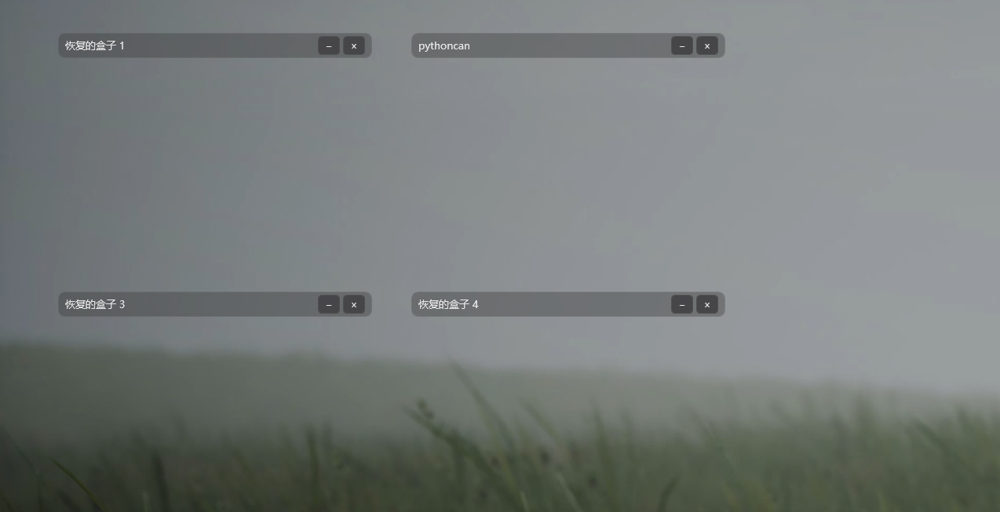

# Tiny DeskBox

[](https://www.microsoft.com/windows)
[](https://dotnet.microsoft.com/)
[](LICENSE)
[](CONTRIBUTING.md)

**English** | [简体中文](#简体中文)

<a id="english"></a>

Tiny DeskBox is a tiny, easy-to-use Windows desktop organizer. It places movable, resizable boxes directly on your desktop so files and shortcuts can stay grouped without turning the desktop into a grid of scattered icons.

It is a focused local utility: no account, no cloud service, and no database server. Your files remain on your computer, while the app remembers each box's position, size, name, collapsed state, appearance, and automatic-collapse preference.



## Why Tiny DeskBox?

- **Tiny workflow:** create a box, drag items into it, and keep working.
- **Easy to use:** boxes behave like lightweight desktop panels with familiar drag, resize, rename, collapse, and context-menu actions.
- **Convenient:** shortcuts, folders, and documents can be grouped by project or purpose while remaining one double-click away.
- **Local by default:** no sign-in and no network service are required.
- **Crash-aware:** layout and settings use atomic writes and retain the ten newest recovery snapshots.
- **Wallpaper friendly:** adjustable opacity helps boxes sit comfortably over static or animated wallpapers.

## Features

- Create multiple independent desktop boxes from the system tray.
- Move and resize boxes anywhere in the Windows work area.
- Rename a box by double-clicking its title.
- Drag files, folders, and shortcuts from the desktop or File Explorer into a box.
- Double-click an item to open it with its normal Windows application.
- Return an item to the desktop from its context menu.
- Collapse boxes manually or automatically when the pointer leaves.
- Pause automatic collapse for an individual box and preserve that state after restart.
- Adjust box opacity, hide desktop icons, and start Tiny DeskBox with Windows.
- Restore the newest valid layout and settings snapshot if a primary state file is damaged.

## How File Storage Works

Dragging an item into a box **moves the original item** into Tiny DeskBox's local storage directory. The item disappears from its previous location because it has been moved, not copied. Returning it to the desktop moves the same item back.

Each box owns a storage folder identified by a stable ID. Layout metadata and application settings are stored separately as JSON, so a damaged layout does not automatically remove the files held by a box.

## Quick Start from Source

Requirements:

- Windows
- [.NET 8 SDK](https://dotnet.microsoft.com/download/dotnet/8.0)
- Git, if cloning the repository

```powershell
git clone https://github.com/W0nderShy/tiny-deskbox.git
cd tiny-deskbox
dotnet restore DeskBox.sln
dotnet test DeskBox.sln -c Release
dotnet run --project src\DeskBox.App\DeskBox.App.csproj -c Release
```

Tiny DeskBox appears in the system tray. Use the tray menu to create boxes, change opacity, toggle automatic collapse, hide desktop icons, enable startup, or exit cleanly.

## Build and Publish

Build the Release configuration:

```powershell
dotnet build DeskBox.sln -c Release
```

Create a self-contained, single-file Windows x64 build:

```powershell
dotnet publish src\DeskBox.App\DeskBox.App.csproj `
  -c Release `
  -r win-x64 `
  --self-contained true `
  -p:PublishSingleFile=true `
  -o artifacts\publish\win-x64
```

The self-contained package includes the .NET runtime and is therefore larger than a framework-dependent build. "Tiny" describes the focused interface and workflow rather than promising a specific binary size.

## Local Data and Recovery

Tiny DeskBox stores runtime data under `%LocalAppData%\DeskBox\`:

| Path | Purpose |
| --- | --- |
| `config.json` | Global settings such as opacity and automatic collapse |
| `layout.json` | Box names, positions, sizes, ordering, and states |
| `storage\{boxId}\` | Files and folders held by each box |
| `recovery\` | The ten newest valid layout and configuration snapshots |

State files are written through a temporary file and atomically replaced. On startup, Tiny DeskBox uses the primary state when it is valid; otherwise it checks recovery snapshots from newest to oldest. If layout metadata cannot be recovered but box storage still exists, the app reconstructs boxes so stored items remain reachable.

## Safety Notes

- Use **Return to desktop** when you want to remove an item from a box without deleting it.
- Deleting a box offers a choice to return its contents to the desktop. Choosing the destructive option removes the box storage directory and its contents.
- The item context menu also contains a permanent delete action. Review the selected item before confirming.
- Keep normal backups for important files. Recovery snapshots protect layout and settings; they are not versioned backups of documents stored inside boxes.

## Current Limitations

- Windows only; the UI depends on WPF and Windows shell APIs.
- No installer or signed binary is published yet.
- No cloud synchronization or multi-device layout support.
- Recovery snapshots protect metadata, not previous versions of user files.

## Roadmap

- Provide a signed release package and a simple installer.
- Improve first-run box naming and recovery labels.
- Add optional import and export for layout settings.
- Expand automated coverage for Windows shell interactions.
- Improve accessibility and multi-monitor behavior.

## Contributing

Issues and pull requests are welcome. Start with [CONTRIBUTING.md](CONTRIBUTING.md), keep changes focused, and include test evidence. For UI changes, attach before-and-after screenshots so behavior can be reviewed without guesswork.

Tiny DeskBox is available under the [MIT License](LICENSE).

---

<a id="简体中文"></a>

# 简体中文

**Tiny DeskBox** 是一个小巧、易用的 Windows 桌面整理工具。它直接在桌面上提供可移动、可缩放的盒子，让文件和快捷方式可以按照项目或用途集中收纳，不必散落成一整屏图标。

它是一个专注于本地使用的小工具：无需账号、无需云服务，也不需要数据库服务器。文件始终保存在你的电脑上，同时程序会记录每个盒子的名称、位置、尺寸、展开或收起状态、外观，以及是否暂停自动折叠。


## 为什么选择 Tiny DeskBox？

- **操作极简：** 新建盒子，把内容拖进去，然后继续工作。
- **容易上手：** 盒子就像轻量的桌面面板，拖动、缩放、重命名、折叠和右键操作都很直观。
- **方便整理：** 快捷方式、文件夹和文档可以按项目或用途分组，双击即可照常打开。
- **默认本地：** 不需要登录，也不依赖网络服务。
- **考虑崩溃恢复：** 布局和设置采用原子写入，并保留最近 10 份恢复快照。
- **适合动态壁纸：** 可调透明度让盒子能自然地显示在静态壁纸或动态壁纸上。

## 功能

- 通过系统托盘创建多个相互独立的桌面盒子。
- 在 Windows 工作区内自由移动和调整盒子尺寸。
- 双击盒子标题即可重命名。
- 从桌面或资源管理器拖入文件、文件夹和快捷方式。
- 双击盒内项目，使用 Windows 默认程序打开。
- 通过右键菜单把项目放回桌面。
- 手动折叠盒子，或让鼠标移开后自动折叠。
- 单独暂停某个盒子的自动折叠，并在重启后保持该状态。
- 调整盒子透明度、隐藏桌面图标，并设置随 Windows 启动。
- 当主布局或设置文件损坏时，自动恢复最近一份有效快照。

## 文件如何存放

把项目拖入盒子时，Tiny DeskBox 会把**原始项目移动**到本地存储目录。因此，它会从原位置消失，这是移动而不是复制。选择“放回桌面”时，同一个项目会被移动回桌面。

每个盒子拥有一个由稳定 ID 标识的存储文件夹。布局信息和程序设置单独保存为 JSON，因此布局文件损坏并不等于盒内文件会被删除。

## 从源码快速开始

需要准备：

- Windows
- [.NET 8 SDK](https://dotnet.microsoft.com/download/dotnet/8.0)
- 如果需要克隆仓库，还需要 Git

```powershell
git clone https://github.com/W0nderShy/tiny-deskbox.git
cd tiny-deskbox
dotnet restore DeskBox.sln
dotnet test DeskBox.sln -c Release
dotnet run --project src\DeskBox.App\DeskBox.App.csproj -c Release
```

启动后，Tiny DeskBox 会出现在系统托盘中。通过托盘菜单可以新建盒子、调整透明度、切换自动折叠、隐藏桌面图标、设置开机启动或正常退出程序。

## 构建与发布

构建 Release 配置：

```powershell
dotnet build DeskBox.sln -c Release
```

发布包含运行时的 Windows x64 单文件版本：

```powershell
dotnet publish src\DeskBox.App\DeskBox.App.csproj `
  -c Release `
  -r win-x64 `
  --self-contained true `
  -p:PublishSingleFile=true `
  -o artifacts\publish\win-x64
```

自包含版本会附带 .NET 运行时，因此文件会比依赖系统运行时的版本更大。“Tiny”强调的是界面和操作流程专注轻巧，并不是对二进制文件大小作出固定承诺。

## 本地数据与恢复机制

Tiny DeskBox 的运行数据保存在 `%LocalAppData%\DeskBox\`：

| 路径 | 用途 |
| --- | --- |
| `config.json` | 透明度、自动折叠等全局设置 |
| `layout.json` | 盒子名称、位置、尺寸、顺序和状态 |
| `storage\{boxId}\` | 每个盒子实际收纳的文件和文件夹 |
| `recovery\` | 最近 10 份有效的布局和设置快照 |

状态文件会先写入临时文件，再通过原子替换更新主文件。程序启动时会优先读取有效的主状态；如果主状态损坏，则从新到旧检查恢复快照。如果布局信息无法恢复但盒子存储目录仍然存在，程序会重新创建盒子，让存储的项目仍然可以访问。

## 安全说明

- 如果只是想把项目移出盒子，请使用“放回桌面”。
- 删除盒子时，程序会询问是否先把内容放回桌面。选择删除内容的选项会移除盒子的存储目录及其中内容。
- 项目右键菜单中也有永久删除操作，确认前请检查所选项目。
- 重要文件仍应使用常规备份。恢复快照保护的是布局和设置，不是盒内文档的历史版本。

## 当前限制

- 仅支持 Windows，界面依赖 WPF 和 Windows Shell API。
- 暂时没有发布安装程序或签名二进制文件。
- 不支持云同步或多设备布局同步。
- 恢复快照只保护元数据，不保存用户文件的旧版本。

## 路线图

- 提供签名发布包和简单安装程序。
- 改进首次创建和恢复盒子时的名称。
- 增加布局设置的可选导入与导出。
- 扩展 Windows Shell 操作的自动化测试。
- 改善无障碍支持和多显示器体验。

## 参与贡献

欢迎提交 Issue 和 Pull Request。请先阅读 [CONTRIBUTING.md](CONTRIBUTING.md)，保持改动范围清晰，并附上测试结果。涉及界面变化时，请提供修改前后的截图，方便维护者直接确认行为差异。

Tiny DeskBox 使用 [MIT License](LICENSE) 开源。
